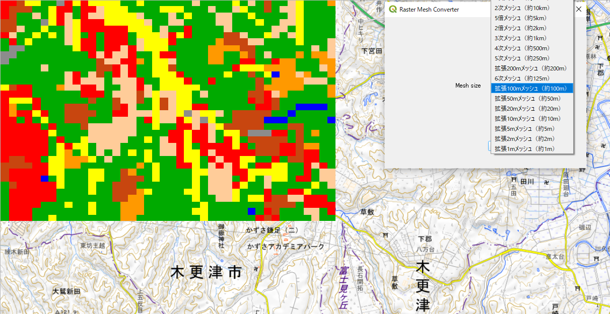
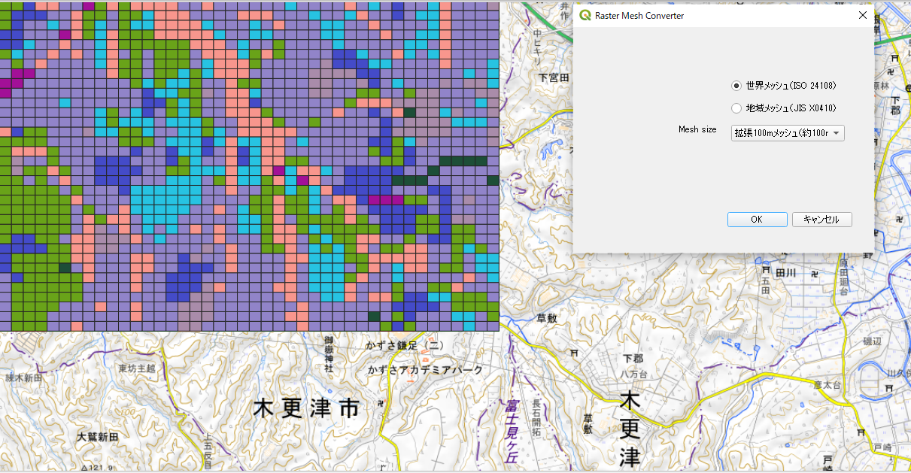

# プロジェクト名

raster_mesh_converterは、QGISのプラグインです。
地理院地図、OpenStreetMapなどの背景地図に表示したラスターデータ（GeoTIFF形式）の世界メッシュ（ISO 24108）または地域メッシュ（JIS X 0410）を表示して、メッシュコードに対応したラスターデータを作成します。

地理院地図を背景地図に利用。
出典：国土数値情報　土地利用細分メッシュ（ラスタ版）（[当該ページのURL](https://nlftp.mlit.go.jp/ksj/gml/datalist/KsjTmplt-L03-b_r.html)）を利用。

## 特徴

- QGISのプラグインで動作します。
- 背景地図の表示範囲のラスターデータに、世界メッシュ（ISO 24108）または地域メッシュ（JIS X 0410）を表示します。

## 動作環境

- QGIS 3.28、3.44で動作確認。
- 背景地図　地理院地図、OpenStreetMap（EPSG:3857）で動作確認。

## インストール

右上の<>CodeのDownload ZIPを選択してファイルをzip形式でダウンロードしてください。

QGIS プラグイン > プラグインの管理とインストール...を開き、ZIPからインストールを選択して、ファイルを指定してインストールしてください。

## 使い方

- 世界メッシュ（ISO 24108）または地域メッシュ（JIS X 0410）を選択します。
- mesh sizeを選択します。
- OKボタンを押します。
- 表示メッシュ数は1000000を限界値に設定しています。
- 属性データには、メッシュコード、ラスターデータの値（value）を表示します。

地理院地図を背景地図に利用。
出典：国土数値情報　土地利用細分メッシュ（ラスタ版）（[当該ページのURL](https://nlftp.mlit.go.jp/ksj/gml/datalist/KsjTmplt-L03-b_r.html)）を利用。

## ライセンス

世界メッシュコードの原著作者は横浜市立大学データサイエンス学部佐藤彰洋教授（一般社団法人世界メッシュ研究所代表理事）です。